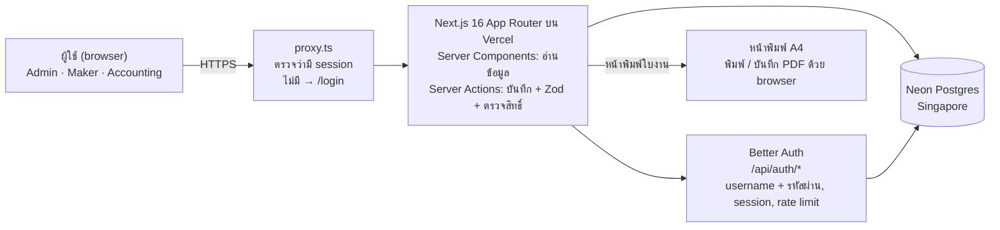

# Design 01 — สถาปัตยกรรมระบบใหม่ (NPPool)

- **วันที่:** 2026-11-26 · **สถานะ:** ⏸ เสนอ — รออนุมัติแบบ (ขั้นที่ 3)
- **อ้างอิง:** ขอบเขต MVP และความต่างที่ตั้งใจ → [03-feature-parity](../rea/03-feature-parity.md) · กฎธุรกิจ → [04-business-rules](../rea/04-business-rules.md) · การตัดสินใจ → [ADR](../adr/README.md)
- **เอกสารชุดเดียวกัน:** [02-screens-and-routes.md](02-screens-and-routes.md) · [03-database.md](03-database.md)

---

## 1. ภาพรวม

เว็บแอปเดียว (Next.js) บน Vercel ต่อ Postgres (Neon) — ไม่มีระบบภายนอกอื่น ไม่มีงานตั้งเวลา ไม่มีไฟล์อัปโหลดใน MVP (ระบบเดิมก็ไม่มี — 01-inventory หัวข้อ 10)



## 2. Tech stack (ตรวจเวอร์ชันจาก npm 2026-11-26 — ตรวจซ้ำตอน scaffold)

| ส่วน | เลือก | เวอร์ชัน | ADR |
|---|---|---|---|
| Framework | Next.js (App Router) + React + TypeScript strict | next 16.4.6 · react 19.3.1 | [0001](../adr/0001-nextjs-on-vercel.md) ✅ |
| Hosting | Vercel (Fluid compute) · region Singapore | — | [0001](../adr/0001-nextjs-on-vercel.md) ✅ |
| Database | Postgres = Neon ผ่าน Vercel Marketplace (Singapore) | — | [0002](../adr/0002-neon-postgres.md) ✅ |
| ORM / migration | Drizzle ORM + drizzle-kit | 0.45.4 / 0.31.11 | [0003](../adr/0003-drizzle-and-db-connection.md) ✅ |
| DB driver | `pg` (node-postgres) Pool + `attachDatabasePool` ของ `@vercel/functions` | pg 8.23.1 · @vercel/functions 3.11.4 | [0003](../adr/0003-drizzle-and-db-connection.md) ⏸ |
| Auth | Better Auth: username plugin + admin plugin, session ในฐานข้อมูล | better-auth 1.7.28 | [0004](../adr/0004-auth-better-auth.md) ⏸ |
| Validation | Zod (ใช้ร่วมกันทั้งฟอร์มและ Server Action) | zod 4.6.7 | — |
| UI | Tailwind CSS v4 + shadcn/ui · react-hook-form · ฟอนต์ไทย | tailwindcss 4.3.5 · shadcn 4.23.1 · react-hook-form 7.92.0 | [0006](../adr/0006-ui-kit-and-thai-fonts.md) ⏸ |
| ใบสั่งปฏิบัติงาน | หน้า HTML สำหรับพิมพ์ A4 → พิมพ์ / บันทึก PDF จาก browser | — | [0005](../adr/0005-job-order-printing.md) ⏸ |
| Test | Vitest (unit) + Playwright (E2E) | 5.1.2 / 1.65.1 | — |
| CI | GitHub Actions: lint, typecheck, unit test, build · Vercel Git Integration: Preview ทุก branch, Production จาก `main` | — | — |

✅ = ผู้ใช้อนุมัติแล้ว · ⏸ = เสนอในขั้นนี้

## 3. หลักการออกแบบ

1. **อ่านใน Server Components, เขียนผ่าน Server Actions** — ไม่มี REST API สำหรับหน้าจอ (มีเฉพาะ route ของ Better Auth)
2. **ทุก Server Action:** ตรวจ session → ตรวจสิทธิ์ (ADR-0009) → validate ด้วย Zod → ทำงานใน transaction ถ้าเขียนหลายตาราง → คืนผลเป็น `{ ok, data } | { ok: false, errors }` เพื่อแสดงข้อความภาษาไทยทุกช่อง (แก้ “บันทึกไม่ผ่านแบบเงียบ” ของระบบเดิม)
3. **เงิน:** เก็บ `numeric(14,2)` · ใน TypeScript ถือเป็น string (Drizzle คืน string) · ห้ามคำนวณด้วย float — ถ้ามีสูตรยอดรวมภายหลัง (WO-17) ใช้ไลบรารีทศนิยมหรือคำนวณเป็นสตางค์
4. **เวลา:** เก็บ `timestamptz` (UTC) · คำนวณ “วัน/เดือนไทย” (เช่น เดือนของเลขที่ใบงาน) ด้วย `Asia/Bangkok` เสมอ เพราะ server บน Vercel เป็น UTC (ADR-0008)
5. **ข้อความ:** UTF-8 ทั้งระบบ · เรียงภาษาไทยด้วย collation ไทยของ Postgres หรือ `Intl.Collator('th')`
6. **ไม่ลบถาวร:** ใบงานใช้ “ยกเลิก” · ข้อมูลพื้นฐานใช้ “ปิดใช้งาน” · มี FK จริงทุกความสัมพันธ์ (ADR-0010)
7. **ไม่ลอกข้อบกพร่อง:** ทุกข้อใน 03-feature-parity หัวข้อ 3 เป็นข้อกำหนดของระบบใหม่

## 4. โครงสร้างโฟลเดอร์ (ร่าง — สร้างจริงในขั้นที่ 4)

```text
├─ src/
│  ├─ app/
│  │  ├─ (auth)/login/page.tsx              หน้า login
│  │  ├─ (app)/layout.tsx                   layout หลัก + เมนูตามบทบาท (ต้องมี session)
│  │  ├─ (app)/page.tsx                     Dashboard
│  │  ├─ (app)/work-orders/…                รายการ / สร้าง / ดู ใบงาน
│  │  ├─ (app)/master/…                     ข้อมูลพื้นฐาน 4 ชุด
│  │  ├─ (app)/admin/users/…                จัดการผู้ใช้
│  │  ├─ (print)/work-orders/[id]/print/    หน้าพิมพ์ A4 (ไม่มีเมนู)
│  │  └─ api/auth/[...all]/route.ts         Better Auth handler
│  ├─ db/
│  │  ├─ schema/                            auth.ts · master-data.ts · work-orders.ts · index.ts
│  │  ├─ client.ts                          pg Pool + attachDatabasePool + drizzle()
│  │  └─ seed.ts                            สถานะงาน · ประเภทรถ · admin คนแรก
│  ├─ features/
│  │  ├─ work-orders/                       actions.ts · queries.ts · schemas.ts (Zod) · numbering.ts · components/
│  │  ├─ customers/ · vehicles/ · drivers/ · routes/ · users/
│  ├─ lib/
│  │  ├─ auth.ts · auth-client.ts           ตั้งค่า Better Auth
│  │  ├─ permissions.ts                     role → สิทธิ์ (02-domain-model หัวข้อ 6.2) + requirePermission()
│  │  └─ format.ts                          วันที่ พ.ศ. / เงิน / เบอร์โทร แบบไทย
│  └─ proxy.ts                              (Next.js 16 แทน middleware.ts) — redirect ผู้ที่ไม่มี session
├─ drizzle/                                 ไฟล์ migration SQL (commit ทุกไฟล์ ตรวจก่อน merge)
├─ tests/unit/ · tests/e2e/                 Vitest · Playwright
├─ .env.example                             ชื่อตัวแปรเท่านั้น ไม่มีค่าจริง
└─ .github/workflows/ci.yml
```

## 5. การเข้าถึงฐานข้อมูล

- **Driver:** `pg` Pool ที่ต่อ connection string แบบ pooled ของ Neon ประกาศระดับ module และส่งเข้า `attachDatabasePool()` เพื่อให้ Vercel ปิด connection ที่ว่างก่อน instance หยุด — ตามคำแนะนำของ Vercel สำหรับ Fluid compute ([Vercel KB](https://vercel.com/kb/guide/efficiently-manage-database-connection-pools-with-fluid-compute), [Neon](https://neon.com/docs/guides/vercel-connection-methods)) · รองรับ transaction แบบ interactive (`db.transaction(...)`) ที่การออกเลขที่ใบงานต้องใช้ (ADR-0003, ADR-0007)
- **Migration:** ใช้ connection แบบ unpooled (direct) · ไฟล์ SQL จาก `drizzle-kit generate` ต้องผ่านการตรวจใน PR ก่อนรัน
- **ชื่อ environment variable จริง** ที่ Neon/Vercel สร้างให้ ตรวจตอนเชื่อมต่อในขั้นที่ 4 (skill.md หัวข้อ 6)

## 6. ความปลอดภัย

| เรื่อง | การออกแบบ | แก้ข้อบกพร่องเดิม |
|---|---|---|
| การยืนยันตัวตน | Better Auth — username + รหัสผ่าน, session เก็บในฐานข้อมูล (เพิกถอนได้), cookie `HttpOnly` + `Secure` | S1, S2 |
| การสร้างบัญชี | Admin เท่านั้น (ไม่มีหน้าสมัครเอง) | S1 |
| สิทธิ์ | deny by default: `proxy.ts` กันผู้ไม่มี session (ตรวจแบบเร็ว) + **ทุก page และทุก Server Action เรียก `requirePermission()`** ตาม role matrix (ADR-0009) | S3, S4 |
| ข้อมูลเข้า | Zod ทุก Server Action (ไม่เชื่อค่าจาก browser) · Server Actions ของ Next.js ตรวจ Origin ให้ (กัน CSRF) | F5 |
| การเดารหัสผ่าน | rate limit ของ Better Auth เก็บในฐานข้อมูล (หน่วยความจำไม่เหมาะกับ serverless) + กฎเฉพาะ `/sign-in/username` | S6 |
| รหัสผ่าน | hash โดย Better Auth · นโยบายไม่ต่ำกว่าเดิม: ≥ 8 ตัว มีพิมพ์ใหญ่ พิมพ์เล็ก ตัวเลข สัญลักษณ์ (ตรวจด้วย Zod ตอน Admin ตั้ง/ผู้ใช้เปลี่ยน) | — |
| ความลับ | Environment Variables ของ Vercel เท่านั้น · repo มีแค่ `.env.example` · `.env*` อยู่ใน `.gitignore` (repo เป็น public) | S5 |
| ฐานข้อมูล | (Should) แยก role ของแอปที่มีสิทธิ์แค่ SELECT/INSERT/UPDATE บนตารางของระบบ ออกจาก role ที่ใช้ migrate | S5 |
| Dependency | ติดตั้งผ่าน npm และ bundle เอง ไม่โหลด script จาก CDN · lockfile commit | S9 |
| ข้อมูลส่วนบุคคล | ไม่เก็บเลขบัตรประชาชน/ที่อยู่ของคนขับ (MD-07 Drop) · ไม่ log ชื่อ/เบอร์โทร · ข้อมูลทดสอบเป็นค่าสมมติ | PDPA |
| Audit | ทุกตารางมี `created_at/by`, `updated_at/by` · การยกเลิกใบงานบันทึกผู้ยกเลิกและเวลา | F2 |

## 7. สภาพแวดล้อมและการ deploy

| Environment | ที่มา | ฐานข้อมูล | หมายเหตุ |
|---|---|---|---|
| Local | `npm run dev` บนเครื่องผู้พัฒนา | Neon branch `dev` ที่สร้างเองใน Neon Console ใส่ค่าลง `.env.local` — ไม่เชื่อม Development environment ของ integration เพราะจะได้ connection ของ branch หลัก (ตรวจขั้นที่ 4) | ห้ามใช้ฐานข้อมูล production |
| Preview | ทุก branch / PR บน Vercel | Neon branch `preview/<git branch>` สร้างจาก branch หลักตอน deploy — ตั้ง “Create database branch for deployment: Preview” ([runbook 01](../runbook/01-vercel-neon-setup.md)) | ใช้ทดสอบ E2E และ UAT · ลบอัตโนมัติเมื่อ deployment ถูกลบ |
| Production | branch `main` | Neon branch หลัก · Singapore | merge เข้า `main` ผ่าน PR เมื่อผู้ใช้สั่งเท่านั้น |

- Build บน Vercel (`npm run vercel-build`): ตรวจ env ที่จำเป็น → migrate → seed → สร้างผู้ดูแลคนแรกจาก `ADMIN_*` ถ้ายังไม่มี → `next build` (ADR-0011) — ขั้นใดไม่ผ่าน build ไม่ผ่านและไม่ deploy
- ตรวจ env ก่อนเพราะ `next build` ผ่านได้แม้ไม่มี `BETTER_AUTH_SECRET` แล้วไปพังตอน login
- Region: Vercel Functions `sin1` + Neon `aws-ap-southeast-1` (Singapore) ให้อยู่ใกล้กัน

## 8. การทดสอบ

| ระดับ | เครื่องมือ | ครอบคลุม |
|---|---|---|
| Unit | Vitest | กฎใน 04-business-rules ที่มีตัวอย่าง input → output: เลขที่ใบงาน (รวมข้ามเดือน/ปี และบันทึกพร้อมกัน), Zod schema ทุกฟอร์ม, จัดรูปแบบวันที่ พ.ศ./เงิน, role → สิทธิ์ |
| Integration | Vitest + PGlite (Postgres ในหน่วยความจำ รัน migration จริง) · กรณีที่ต้องใช้หลาย connection พร้อมกันใช้ Neon branch ทดสอบ | การออกเลขที่ใบงาน · FK และ check constraint · Better Auth (username, ระงับบัญชี, session 30 นาทีด้วยนาฬิกาจำลอง) |
| E2E | Playwright บน Preview | UC-01 ถึง UC-09 (02-domain-model หัวข้อ 7) · ทุกบทบาท × ทุก route ตาม role matrix · หน้าพิมพ์ |
| ตรวจด้วยตา | ผู้ใช้ (UAT ขั้นที่ 7) | หน้าตา, ภาษา, ใบสั่งปฏิบัติงานเทียบแบบเดิม |

## 9. สิ่งที่ต้องตรวจจริงในขั้นที่ 4 (ก่อนเขียนโค้ด)

1. ✅ `DATABASE_URL` (pooled) / `DATABASE_URL_UNPOOLED` (direct) · branch ต่อ Preview เปิดได้ที่การเชื่อม project (หัวข้อ 7)
2. ✅ `pg` Pool ระดับ module + `attachDatabasePool(pool)` + `drizzle({ client: pool })` (`src/db/client.ts`)
3. ✅ Better Auth: `createUser` + `data.username` และอีเมลสมมติ ผ่าน integration test (ADR-0004 หัวข้อผลตรวจ)
4. ✅ ปฏิทินเลือกวันของ shadcn/ui (react-day-picker 10) แสดงปี พ.ศ. ด้วย `formatCaption` + locale ไทย (ADR-0008 ผลตรวจ)
5. หน้าพิมพ์: ผลการพิมพ์ A4 บน Chrome/Edge และชื่อไฟล์เมื่อบันทึกเป็น PDF (ADR-0005)
