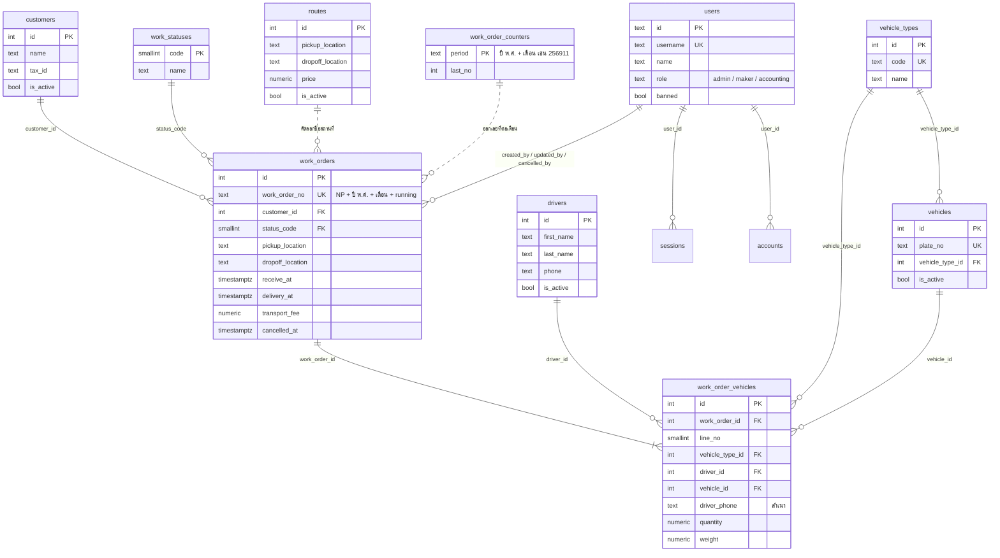

# Design 03 — ฐานข้อมูล Postgres และ mapping จากระบบเดิม (NPPool)

- **วันที่:** 2026-11-26 · **สถานะ:** ⏸ เสนอ — รออนุมัติแบบ (ขั้นที่ 3)
- **อ้างอิง:** data dictionary เดิม → [02-domain-model หัวข้อ 4](../rea/02-domain-model.md) · กฎ → [04-business-rules](../rea/04-business-rules.md) · [ADR-0003](../adr/0003-drizzle-and-db-connection.md), [ADR-0007](../adr/0007-work-order-numbering.md), [ADR-0010](../adr/0010-no-hard-delete.md), [ADR-0011](../adr/0011-migrations-and-seed-data.md)
- **รูปแบบ:** ตารางและคอลัมน์ `snake_case` · โค้ด TypeScript `camelCase` (Drizzle map ให้) · เขียนเป็นตารางอธิบาย — Drizzle schema จริงเขียนในขั้นที่ 4

---

## 1. หลักการ

1. ทุกตารางของระบบมี `id integer generated always as identity` เป็น PK (ยกเว้นตารางรหัส) และมี **FK จริงทุกความสัมพันธ์** (ระบบเดิมไม่มีเลย)
2. audit ทุกตาราง: `created_at`, `updated_at` (`timestamptz not null default now()`) + `created_by`, `updated_by` (FK → `users.id`)
3. ข้อมูลพื้นฐานมี `is_active boolean not null default true` — ปิดใช้งานแทนการลบ (ADR-0010)
4. เงิน `numeric(14,2)` + `check (≥ 0)` · จำนวนนับ `smallint` + `check` ช่วงค่า · ข้อความ `text` UTF-8
5. เวลา `timestamptz` เก็บ UTC · การคำนวณเชิงวัน/เดือน (เช่น เดือนของเลขที่ใบงาน) ใช้ `Asia/Bangkok` (ADR-0008)
6. ชื่อสถานที่ในใบงานเป็นข้อความที่คัดลอกจากข้อมูลสถานที่รับ-ส่ง (เหมือนระบบเดิม) — แก้ข้อมูลพื้นฐานภายหลังไม่กระทบใบงานเก่า · เบอร์คนขับในรายการรถก็เป็นสำเนาเช่นกัน
7. เรียงข้อความไทยด้วย ICU collation ภาษาไทยของ Postgres (เช่น `"th-x-icu"`) — ตรวจว่า Neon มีให้ในขั้นที่ 4

## 2. ER diagram (ระบบใหม่)



## 3. ตาราง

### 3.1 `work_orders` — ใบงาน

| คอลัมน์ | ชนิด | Null | ค่าเริ่มต้น / ข้อจำกัด | หมายเหตุ |
|---|---|---|---|---|
| `id` | integer identity | ไม่ | PK | |
| `work_order_no` | text | ไม่ | **unique** | ออกโดยระบบ (ADR-0007) |
| `customer_id` | integer | ไม่ | FK → `customers` | ต้องเป็นรายการที่ใช้งานอยู่ตอนสร้าง (ตรวจในแอป) |
| `ordered_by` | text | ได้ | | ผู้สั่งงาน |
| `status_code` | smallint | ไม่ | default 1 · FK → `work_statuses` | |
| `pickup_location`, `dropoff_location` | text | ได้ | | ข้อความจาก `routes` |
| `pickup_contact_name`, `pickup_contact_phone` | text | ได้ | | |
| `dropoff_contact_name`, `dropoff_contact_phone` | text | ได้ | | |
| `receive_at`, `delivery_at` | timestamptz | ได้ | check `delivery_at >= receive_at` เมื่อมีทั้งคู่ | เก็บวัน+เวลา (Q14) |
| `customer_job_no` | text | ได้ | | Job No., Shipment |
| `remark` | text | ได้ | | |
| `transport_fee` | numeric(14,2) | ได้ | check ≥ 0 | ค่าขนส่ง |
| `port_fee`, `demurrage_fee` | numeric(14,2) | ได้ | check ≥ 0 | ค่าผ่านท่า, ค่าเสียเวลา |
| `overnight_nights` | smallint | ไม่ | default 0 · check 0–15 | จำนวนคืน (เดิม `FeeOvernight`) |
| `overnight_labor_fee` | numeric(14,2) | ได้ | check ≥ 0 | ค่าแรงค้างคืน |
| `extra_workers` | smallint | ไม่ | default 0 · check 0–15 | จำนวนคน (เดิม `Overhead`) |
| `extra_worker_fee` | numeric(14,2) | ได้ | check ≥ 0 | ค่าแรงคน |
| `cancelled_at`, `cancelled_by` | timestamptz, text | ได้ | FK `cancelled_by` → `users` · check: `(status_code = 2) = (cancelled_at is not null)` | ยกเลิก = สถานะ 2 เท่านั้น (ADR-0010) |
| `created_at`, `created_by`, `updated_at`, `updated_by` | | ไม่ | audit มาตรฐาน | |

ตอนสร้างใบงาน dropdown สถานะ**ไม่มี “ยกเลิก”** (ยกเลิกผ่านปุ่มเท่านั้น เพื่อให้ check ข้างบนเป็นจริงเสมอ) — ระบบเดิมเลือกได้ทั้ง 8 สถานะ

### 3.2 `work_order_vehicles` — รถในใบงาน

| คอลัมน์ | ชนิด | Null | ค่าเริ่มต้น / ข้อจำกัด | หมายเหตุ |
|---|---|---|---|---|
| `id` | integer identity | ไม่ | PK | |
| `work_order_id` | integer | ไม่ | FK → `work_orders` **on delete cascade** | |
| `line_no` | smallint | ไม่ | unique (`work_order_id`, `line_no`) | ลำดับคันในใบงาน |
| `vehicle_type_id`, `driver_id`, `vehicle_id` | integer | ได้ | FK → `vehicle_types`, `drivers`, `vehicles` | |
| `driver_phone` | text | ได้ | | สำเนาเบอร์คนขับตอนบันทึก |
| `quantity`, `weight` | numeric(12,2) | ได้ | check ≥ 0 | |
| `quantity_unit`, `weight_unit`, `dimensions` | text | ได้ | | หน่วยตามคำตอบ Q16 |

กฎ “อย่างน้อย 1 คันที่มีข้อมูล” และ “ไม่บันทึกแถวว่าง” ตรวจใน Server Action (Zod) — ฐานข้อมูลตรวจข้ามตารางแบบนี้ไม่ได้ง่ายๆ

### 3.3 ข้อมูลพื้นฐาน

| ตาราง | คอลัมน์หลัก (นอกจาก `id`, `is_active`, audit) | ข้อจำกัด | index |
|---|---|---|---|
| `customers` | `name` text not null · `address` text not null · `phone` text not null · `tax_id` text not null | (Should) `tax_id` เป็นตัวเลข 13 หลัก — ตรวจในแอป | `name` |
| `drivers` | `first_name` text not null · `last_name` text not null · `phone` text | — | (`first_name`, `last_name`) |
| `vehicle_types` | `code` text not null · `name` text not null · `sort_order` smallint default 0 | unique `code` | — |
| `vehicles` | `plate_no` text not null · `vehicle_type_id` integer not null FK | **unique `plate_no`** (ตัดช่องว่างหัวท้ายก่อนบันทึก) | `vehicle_type_id` |
| `routes` | `pickup_location` text not null · `dropoff_location` text not null · `price` numeric(14,2) not null | check `price >= 0` · ยังไม่บังคับคู่ไม่ซ้ำ (รอ Q12) | `pickup_location`, `dropoff_location` |

### 3.4 ตารางรหัสและตัวนับ

| ตาราง | คอลัมน์ | หมายเหตุ |
|---|---|---|
| `work_statuses` | `code` smallint PK · `name` text not null · `sort_order` smallint | seed 8 ค่าจากฐานข้อมูลเดิม (หัวข้อ 6) |
| `work_order_counters` | `period` text PK (ปี พ.ศ. 4 หลัก + เดือน 2 หลัก) · `last_no` integer not null check ≥ 1 | 1 แถวต่อเดือน (ADR-0007) |

### 3.5 ตารางของ Better Auth

สร้างด้วย CLI ของ Better Auth แล้วตั้งชื่อเป็นพหูพจน์ `snake_case` ให้เข้ากับตารางอื่น (`users` แทน `user` ซึ่งเป็นคำสงวนของ Postgres) — ยืนยันวิธีตั้งชื่อตอนขั้นที่ 4 (ADR-0004)

| ตาราง | คอลัมน์สำคัญ | มาจาก |
|---|---|---|
| `users` | `id`, `name` (ชื่อ-นามสกุล), `email` (อีเมลสมมติ — ADR-0004), `username`, `display_username`, `role`, `banned`, `ban_reason`, `ban_expires`, `phone` (ฟิลด์เพิ่ม), audit | core + username plugin + admin plugin |
| `sessions` | `id`, `token`, `user_id`, `expires_at`, `ip_address`, `user_agent`, `impersonated_by` | core + admin plugin |
| `accounts` | `user_id`, `provider_id` = credential, `password` (hash) | core |
| `verifications` | ตามที่ไลบรารีสร้าง | core |
| `rate_limits` | key, count, last request | core (เมื่อเก็บ rate limit ในฐานข้อมูล) |

## 4. Index ที่ต้องมี (นอกจาก PK, unique และ FK ด้านบน)

| ตาราง | Index | ใช้กับ |
|---|---|---|
| `work_orders` | `customer_id` · `status_code` · `receive_at` | กรองในหลัง MVP (WO-16) · เช็กก่อนลบผู้ว่าจ้าง |
| `work_order_vehicles` | `driver_id` · `vehicle_id` · `vehicle_type_id` | เช็ก “ถูกใช้ในใบงานแล้ว” ก่อนลบข้อมูลพื้นฐาน |

รายการใบงานเรียง `id desc` ใช้ PK ได้เลย

## 5. การออกเลขที่ใบงาน (สรุปจาก ADR-0007)

ใน **transaction เดียวกับ**การบันทึกใบงานและรถ:

```sql
-- $1 = period ปี พ.ศ. + เดือน ตามเวลา Asia/Bangkok เช่น '256911'
INSERT INTO work_order_counters (period, last_no)
VALUES ($1, 1)
ON CONFLICT (period) DO UPDATE SET last_no = work_order_counters.last_no + 1
RETURNING last_no;
```

- `ON CONFLICT ... DO UPDATE` ล็อกแถวของเดือนนั้นจนจบ transaction → บันทึกพร้อมกันได้เลขเรียงกันไม่ซ้ำ · ถ้าบันทึกใบงานล้มเหลว ตัวนับย้อนกลับด้วย (ไม่มีเลขหาย)
- เลขที่ = `'NP' + period + running` โดยเติมศูนย์ให้ครบ 4 หลัก**ใน TypeScript** (`String(n).padStart(4, '0')`) — ห้ามใช้ `lpad()` ของ Postgres เพราะตัดข้อความที่ยาวเกิน (`lpad('10000', 4, '0')` = `'1000'`)
- เกิน 9,999 ใบต่อเดือน → running ยาวเป็น 5 หลักต่อไปได้ (ค่าเริ่มต้นจนกว่าจะได้คำตอบ Q18)
- unique บน `work_order_no` เป็นด่านสุดท้ายกันเลขซ้ำ · ยกเลิกใบงานแล้วเลขไม่ถูกนำกลับมาใช้

## 6. Mapping จากระบบเดิม → ระบบใหม่

ใช้เป็นหลักฐานว่าทุกคอลัมน์เดิมถูกพิจารณาแล้ว — **ไม่มีการย้ายข้อมูลธุรกรรม** (D8: ฐานข้อมูลเดิมไม่มีใบงาน) ย้ายเฉพาะค่าอ้างอิงในหัวข้อ 7

| ตารางเดิม | ตารางใหม่ | คอลัมน์ (เดิม → ใหม่) | ตัดทิ้ง (เหตุผล) |
|---|---|---|---|
| `WorkOrders` | `work_orders` | `WorkOrderNo` → `work_order_no` · `CustomerId` → `customer_id` · `ContactPerson` → `ordered_by` · `WorkStatusId` → `status_code` · `PickupLocation` → `pickup_location` · `PickerUser`/`PickerTel` → `pickup_contact_name`/`_phone` · `DropoffLocation` → `dropoff_location` · `DropoffUser`/`DropoffTel` → `dropoff_contact_name`/`_phone` · `JobReceiveDate` → `receive_at` · `JobDeliveryDate` → `delivery_at` · `JobShipmentNo` → `customer_job_no` · `JobRemark` → `remark` · `TransportationCost` → `transport_fee` · `FeePort` → `port_fee` · `FeeDemurrage` → `demurrage_fee` · `FeeOvernight` → `overnight_nights` · `FeeLabor` → `overnight_labor_fee` · `Overhead` → `extra_workers` · `OverheadCost` → `extra_worker_fee` · `Created*`/`Modified*` → audit | `Pickup*Id`, `Dropoff*Id` ×8 (WO-19 Drop) · `JobTime` (รวมใน `receive_at`) · `Mileage` (WO-20 Drop) |
| `WorkOrderDetails` | `work_order_vehicles` | `WorkOrderId` → `work_order_id` · (ใหม่) `line_no` · `VehicleTypeId`/`DriverId`/`VehicleId` → `*_id` · `DriverTel` → `driver_phone` · `Quantity`/`QuantityUnit` → `quantity`/`quantity_unit` · `Weight`/`WeightUnit` → `weight`/`weight_unit` · `Dimensions` → `dimensions` | — |
| `Customers` | `customers` | `Name` → `name` · `Address` → `address` · `TEL` → `phone` · `IDCard` → `tax_id` · audit | — |
| `Employee` | `drivers` | `FirstName` → `first_name` · `LastName` → `last_name` · `Tel` → `phone` · audit | `EMP_ID`, `Address`, `IDCard` (MD-07 Drop — ลดข้อมูลอ่อนไหว) |
| `Vehicles` | `vehicles` | `LicensePlate` → `plate_no` · `VehicleTypeId` → `vehicle_type_id` · audit | `Name` (ไม่ได้ใช้) · `VehicleType` (สำเนาชื่อ ใช้ FK แทน) · `VehicleBrandId` (MD-06 Drop) |
| `VehicleTypes` | `vehicle_types` | `VehicleType` → `code` · `VehicleName` → `name` · (ใหม่) `sort_order` | ค่าเดิมเป็นข้อมูลตัวอย่าง (Q22) |
| `VehicleBrand` | — | — | ทั้งตาราง (MD-06 Drop) |
| `Location_From_To` | `routes` | `Location_From` → `pickup_location` · `Location_To` → `dropoff_location` · `Price` → `price` · `CreateDT`/`CreateBy` → `created_at`/`created_by` | — |
| `Lookup_PickDropLocation` | — | — | ทั้งตาราง (Q23 — ไม่มีโค้ดใช้) |
| `WorkFlow_Status` | `work_statuses` | `Code` → `code` · `Description` → `name` · (ใหม่) `sort_order` | — |
| `Users` | `users` (Better Auth) | `Username` → `username` · `FirstName` + `LastName` → `name` · `Tel` → `phone` · `RoleType` → `role` (ตัวพิมพ์เล็ก) | `PasswordHash` (AUTH-09 Drop — Admin สร้างบัญชีใหม่) |
| `Master_DOPA` | — | — | ทั้งตาราง (WO-19 Drop / Q24) |
| view 14 ตัว | — | — | เขียนเป็น query ใน `features/*/queries.ts` |

## 7. ข้อมูลตั้งต้น (seed)

| ข้อมูล | ค่า | ที่มา | ใครเตรียม |
|---|---|---|---|
| `work_statuses` | 1 เปิดใบงาน · 2 ยกเลิก · 3 พิมพ์ใบสั่งงาน · 4 จัดรถ · 5 ใส่ราคา · 6 เก็บเงินสด · 7 วางบิล · 8 ตรวจใบงาน · `sort_order` ตามรหัสจนกว่าจะได้คำตอบ Q10 | ฐานข้อมูลเดิม (ยืนยันแล้ว) | seed ใน repo |
| `vehicle_types` | **รายการจริงจากผู้ใช้** (Q22) · ระหว่างพัฒนาใช้ค่าตัวอย่างที่ระบุชัดว่าเป็นตัวอย่าง | ผู้ใช้ | ผู้ใช้ส่งรายการ |
| Admin คนแรก | ชื่อผู้ใช้และรหัสผ่านตั้งตอนรันสคริปต์ (อ่านจาก environment variable ตอนรัน ไม่ commit) | — | ผู้ใช้รันเองในขั้นที่ 4 |
| ข้อมูลพื้นฐานอื่น | ผู้ใช้กรอกผ่านหน้าจอ (ฐานข้อมูลเดิมมีแต่ข้อมูลทดสอบ) | — | ผู้ใช้ |

## 8. ขั้นตอน migration

1. แก้ Drizzle schema → `drizzle-kit generate` สร้างไฟล์ SQL ใน `drizzle/`
2. ตรวจไฟล์ SQL ใน Pull Request (ห้ามแก้ไฟล์ migration ที่รันไปแล้ว)
3. build ของ Vercel รัน `drizzle-kit migrate` ด้วย connection แบบ unpooled ก่อน `next build` — แต่ละ environment migrate ฐานข้อมูลของตัวเอง (ADR-0011)
4. ก่อน migration ที่ลบ/เปลี่ยนชนิดคอลัมน์บน production: สำรองด้วย Neon branch (สร้าง branch จาก production ไว้ก่อน)
