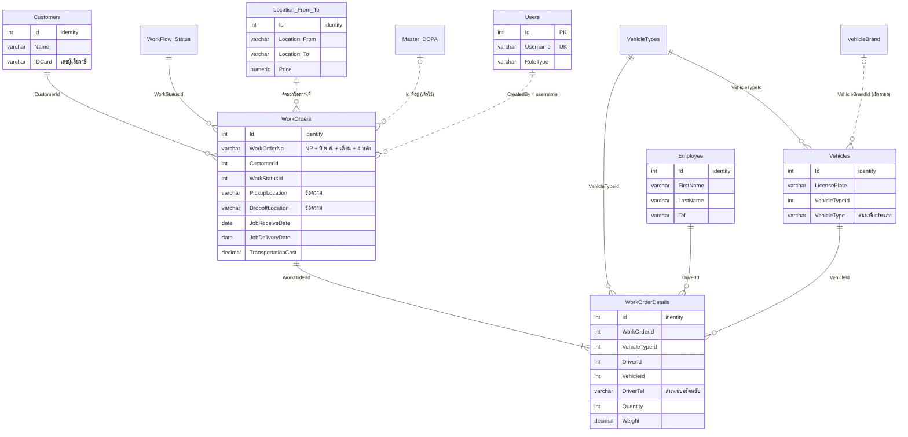
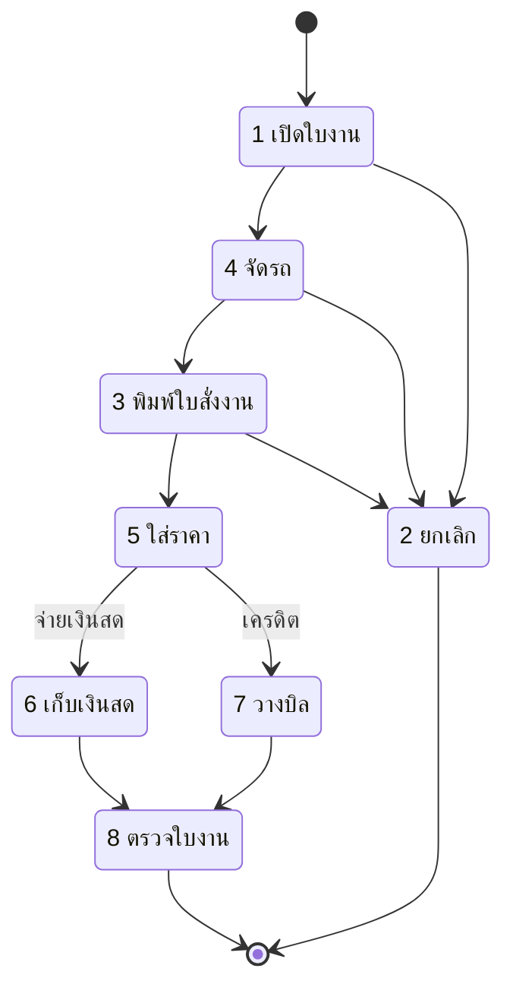
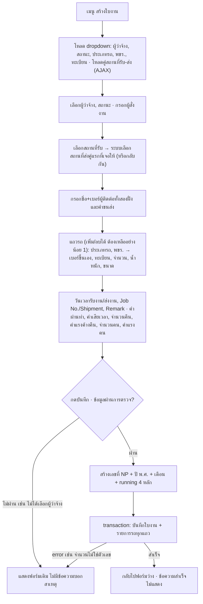

# 02 — Domain model, data dictionary, บทบาท และ user flow (NPPool ระบบเดิม)

- **ที่มา:** ซอร์สล่าสุด `C:\Projects\NPPool` (2026-06-28) · schema จาก `Database/TCRMIS_Database.xlsx` + ฐานข้อมูล `TCRMIS.NPPOOL` บนเครื่องผู้ใช้ · บันทึก requirement `Gemini_NPPOOL.txt`
- **วันที่:** 2026-11-26 · **สถานะ:** ⏸ รอผู้ใช้ยืนยันว่าถอดแบบถูกต้อง
- **เอกสารชุดเดียวกัน:** [01-inventory.md](01-inventory.md) · [03-feature-parity.md](03-feature-parity.md) · [04-business-rules.md](04-business-rules.md)
- **การอ้างอิงไฟล์:** เหมือน 01-inventory — path นับจาก `C:\Projects\NPPool\NPPool\`; ไฟล์ระดับบนสุดขึ้นต้นด้วย `../`
- **ข้อจำกัด:** ฐานข้อมูลไม่มีใบงานจริงเลย (01-inventory หัวข้อ 8.0) — ทุกอย่างในเอกสารนี้ถอดจากโค้ดและ requirement ไม่ได้ยืนยันจากรูปแบบข้อมูลจริง · ตัวอย่างค่าทั้งหมดเป็น**ค่าสมมติ**

---

## 1. คำศัพท์ (Glossary)

ชื่อในระบบใหม่เป็นร่างสำหรับขั้นที่ 3 (ตาราง `snake_case`, โค้ด `camelCase` ตาม skill.md หัวข้อ 5.2)

| คำที่ผู้ใช้เรียก | ความหมาย | ชื่อในระบบเดิม | ชื่อในระบบใหม่ (ร่าง) |
|---|---|---|---|
| ใบงาน / ใบรับ-ส่ง / ใบสั่งปฏิบัติงาน | งานขนส่ง 1 งานที่ผู้ว่าจ้างสั่ง | `WorkOrders` | `work_orders` |
| เลขที่ใบรับ-ส่ง / NP Job No | เลขที่เอกสารของใบงาน | `WorkOrderNo` | `work_order_no` |
| ผู้ว่าจ้าง | ลูกค้า (บริษัท) ที่ว่าจ้างขนส่ง | `Customers` | `customers` |
| ผู้สั่งงาน | คนฝั่งลูกค้าที่สั่งงานนี้ | `ContactPerson` | `ordered_by` |
| สถานที่รับ / สถานที่ส่ง | ต้นทาง / ปลายทางของสินค้า | `PickupLocation` / `DropoffLocation` | `pickup_location` / `dropoff_location` |
| ผู้ติดต่อ (รับ / ส่ง) | ชื่อและเบอร์ของคนที่ต้นทาง / ปลายทาง | `PickerUser`, `PickerTel` / `DropoffUser`, `DropoffTel` | `pickup_contact_name/phone`, `dropoff_contact_name/phone` |
| รายการรถ | รถ 1 คันในใบงาน + คนขับ + สินค้าที่บรรทุก | `WorkOrderDetails` | `work_order_vehicles` |
| พขร. (พนักงานขับรถ) | คนขับรถ | `Employee` | `drivers` |
| รถ / ทะเบียน | รถที่ใช้ขนส่ง | `Vehicles.LicensePlate` | `vehicles.plate_no` |
| ประเภทรถ | ชนิดรถ (ควรเป็นแบบรถบรรทุก เช่น 4 ล้อ / 6 ล้อ — Q22) | `VehicleTypes` | `vehicle_types` |
| ยี่ห้อรถ | ยี่ห้อ (เอาออกจากฟอร์มแล้ว) | `VehicleBrand` | `vehicle_brands` (ถ้ายังใช้) |
| สถานที่รับ-ส่ง (คู่) + ราคา | คู่ต้นทาง→ปลายทางที่ใช้บ่อย พร้อมราคา | `Location_From_To` | `routes` |
| ค่าขนส่ง | ราคาค่าขนส่งของใบงาน | `TransportationCost` | `transport_fee` |
| ค่าผ่านท่า | ค่าผ่านท่าเรือ/ท่ารถ | `FeePort` | `port_fee` |
| ค่าเสียเวลา | ค่ารอ (demurrage) | `FeeDemurrage` | `demurrage_fee` |
| จำนวนคืน | จำนวนคืนที่ค้างคืน (**ไม่ใช่จำนวนเงิน**) | `FeeOvernight` | `overnight_nights` |
| ค่าแรงค้างคืน | ค่าแรงเมื่อค้างคืน | `FeeLabor` | `overnight_labor_fee` |
| จำนวนคน | คนงานเพิ่ม (ยก/ขนสินค้า) | `Overhead` | `extra_workers` |
| ค่าแรงคน | ค่าแรงคนงานเพิ่ม | `OverheadCost` | `extra_worker_fee` |
| Job No., Shipment | เลขอ้างอิงงานของลูกค้า | `JobShipmentNo` | `customer_job_no` |
| สถานะงาน | ขั้นตอนของใบงาน 8 ค่า | `WorkFlow_Status` | `work_statuses` |
| ใบวางบิล | เอกสารเรียกเก็บเงิน (ยังไม่มีในระบบเดิม) | — | `billing_notes` |
| Maker / Accounting / Admin | บทบาทผู้ใช้: ผู้ทำใบงาน / บัญชี / ผู้ดูแลระบบ | `Users.RoleType` | `users.role` |

## 2. Domain model (เชิงแนวคิด)

| Entity | คืออะไร | ข้อมูลหลัก | ความสัมพันธ์ | กฎคงที่ (invariant) | ในระบบเดิม |
|---|---|---|---|---|---|
| **ใบงาน** | งานขนส่ง 1 งาน | เลขที่, ผู้ว่าจ้าง, ผู้สั่งงาน, สถานะ, ต้นทาง/ปลายทาง + ผู้ติดต่อ, วันรับ/ส่งงาน, เลขงานลูกค้า, หมายเหตุ, ค่าขนส่ง, ค่าใช้จ่ายเพิ่มเติม 6 ช่อง | ผู้ว่าจ้าง 1 · สถานะ 1 · รายการรถ ≥ 1 | เลขที่ไม่ซ้ำ (BR-WO-01) · เงิน ≥ 0 | ✅ |
| **รายการรถ** | รถ 1 คันในใบงาน | ประเภทรถ, คนขับ, รถ, เบอร์คนขับ (สำเนา), จำนวน+หน่วย, น้ำหนัก+หน่วย, ขนาด | ใบงาน 1 · ประเภทรถ 0..1 · คนขับ 0..1 · รถ 0..1 | อยู่ภายใต้ใบงานเสมอ (ลบพร้อมใบงาน) | ✅ |
| **ผู้ว่าจ้าง** | ลูกค้า | ชื่อบริษัท, ที่อยู่, เบอร์, เลขผู้เสียภาษี | ใบงาน 0..* | บังคับทั้ง 4 ช่อง | ✅ |
| **พนักงานขับรถ** | คนขับ | ชื่อ, นามสกุล, เบอร์ (+ รหัสพนักงาน, เลขบัตร, ที่อยู่ — Q20) | รายการรถ 0..* | บังคับชื่อ-นามสกุล | ✅ |
| **รถ** | รถที่ใช้ขนส่ง | ทะเบียน, ประเภทรถ (+ ยี่ห้อ) | ประเภทรถ 1 · รายการรถ 0..* | บังคับทะเบียนและประเภท | ✅ |
| **ประเภทรถ** | ชนิดรถ | รหัส, ชื่อ | รถ 0..* · รายการรถ 0..* | — | ✅ ไม่มีหน้าจอ |
| **ยี่ห้อรถ** | ยี่ห้อ | ชื่อ | รถ 0..* | — | 🟨 เลิกกรอก |
| **คู่สถานที่รับ-ส่ง** | ต้นทาง→ปลายทางที่ใช้บ่อย | ต้นทาง, ปลายทาง, ราคา | ใบงาน (คัดลอกชื่อไปเป็นข้อความ) | — | ✅ |
| **สถานะงาน** | ขั้นตอนของใบงาน | รหัส 1–8, ชื่อ | ใบงาน 0..* | ค่าคงที่ 8 ค่า | ✅ เปลี่ยนสถานะไม่ได้ |
| **ผู้ใช้** | คนที่ login | username, รหัสผ่าน (hash), ชื่อ, นามสกุล, เบอร์, บทบาท | บันทึกเป็นผู้สร้าง/ผู้แก้ไข (ข้อความ) | username ไม่ซ้ำ · 1 คน 1 บทบาท | ✅ |
| **เขตการปกครอง (DOPA)** | จังหวัด/อำเภอ/ตำบล/รหัสไปรษณีย์ | รหัส + ชื่อไทย/อังกฤษ | (เคย) ที่อยู่ต้นทาง/ปลายทาง | ข้อมูลสาธารณะ | 🟨 เลิกใช้ในฟอร์ม (Q24) |
| **ใบวางบิล** | เอกสารเรียกเก็บเงินจากใบงาน | — | ใบงาน | — | ❌ มีแค่เมนู (Q11) |

## 3. ER diagram ระบบเดิม

ฐานข้อมูลเดิม**ไม่มี FK เลย** — เส้นทึบ = ความสัมพันธ์ที่โค้ดใช้ join จริง, เส้นประ = คัดลอกเป็นข้อความหรือเลิกใช้แล้ว

ไม่ได้วาด: `VehicleTypes`, `VehicleBrand`, `WorkFlow_Status` (ตารางรหัส-ชื่อ), `Lookup_PickDropLocation` (เลิกใช้), `Master_DOPA` (ดูหัวข้อ 4.12) และ view 14 ตัว (เป็น query สำเร็จรูป — ระบบใหม่เขียนเป็น query แทน)

## 4. Data dictionary

“ชนิดใหม่ (ร่าง)” ใช้กฎแปลงใน skill.md หัวข้อ 5.3 — ยืนยันในขั้นที่ 3 · ทุกคอลัมน์ข้อความเดิมเป็น `varchar` code page 874 → ระบบใหม่ `text` UTF-8 · คอลัมน์ audit (`Created*` / `Modified*`) ของทุกตารางระบบใหม่ใช้ `created_at`, `updated_at` (`timestamptz`) + `created_by`, `updated_by` (อ้างผู้ใช้) ตามข้อตกลง จึงไม่เขียนซ้ำในทุกตาราง

### 4.1 `WorkOrders` — ใบงาน (36 คอลัมน์)

| คอลัมน์ | ชนิดเดิม | Null | ความหมาย | ตัวอย่าง (สมมติ) | ชนิดใหม่ (ร่าง) | หมายเหตุ |
|---|---|---|---|---|---|---|
| `Id` | int identity | ไม่ | รหัสใบงาน | 15 | integer identity PK | เดิมไม่มี PK |
| `WorkOrderNo` | varchar(50) | ไม่ | เลขที่ใบรับ-ส่ง | NP2568100001 | text unique | สร้างอัตโนมัติ (BR-WO-01) · เดิมไม่มี unique |
| `CustomerId` | int | ไม่ | ผู้ว่าจ้าง | 3 | integer FK → customers | ต้องเลือก (BR-WO-03) |
| `ContactPerson` | varchar(100) | ได้ | ผู้สั่งงาน | คุณ ก. | text | ข้อมูลส่วนบุคคล · ใบพิมพ์ใช้เป็น “ผู้ติดต่อ” ต้นทาง |
| `WorkStatusId` | int | ไม่ | สถานะงาน (1–8) | 1 | smallint FK → work_statuses | หัวข้อ 5 |
| `PickupLocation` | varchar(255) | ได้ | สถานที่รับ | คลังสินค้า A | text | คัดลอกชื่อจากคู่สถานที่ (ไม่ใช่ FK) |
| `PickupProvinceId`, `PickupDistrictId`, `PickupTambonId`, `PickupPostcodeId` | int | ได้ | ที่อยู่ฝั่งรับตาม DOPA | NULL | ตัดทิ้ง หรือ FK ถ้าต้องใช้ (Q24) | เอาออกจากฟอร์มแล้ว · ชนิดไม่ตรงกับ DOPA (`varchar`) |
| `PickerUser` | varchar(255) | ได้ | ชื่อผู้ติดต่อ (รับ) | คุณ ข. | text | ข้อมูลส่วนบุคคล |
| `PickerTel` | varchar(50) | ได้ | เบอร์โทร (รับ) | 08x-xxx-xxxx | text | ข้อมูลส่วนบุคคล · ไม่ตรวจรูปแบบ |
| `DropoffLocation` | varchar(255) | ได้ | สถานที่ส่ง | โรงงาน B | text | เหมือน `PickupLocation` |
| `DropoffProvinceId`, `DropoffDistrictId`, `DropoffTambonId`, `DropoffPostcodeId` | int | ได้ | ที่อยู่ฝั่งส่งตาม DOPA | NULL | ตัดทิ้ง หรือ FK (Q24) | เหมือนฝั่งรับ |
| `DropoffUser` | varchar(255) | ได้ | ชื่อผู้ติดต่อ (ส่ง) | คุณ ค. | text | ข้อมูลส่วนบุคคล |
| `DropoffTel` | varchar(50) | ได้ | เบอร์โทร (ส่ง) | 08x-xxx-xxxx | text | ข้อมูลส่วนบุคคล |
| `JobReceiveDate` | date | ได้ | วันที่รับงาน | 2025-10-05 | timestamptz ถ้าเก็บเวลา (Q14) | ฟอร์มเลือกเวลาได้แต่เวลาหาย (F3) |
| `JobDeliveryDate` | date | ได้ | วันที่ส่งงาน | 2025-10-06 | timestamptz (Q14) | ไม่ตรวจว่าไม่ก่อนวันรับ |
| `JobShipmentNo` | varchar(100) | ได้ | Job No., Shipment ของลูกค้า | SHP-0001 | text | ใบพิมพ์ยังไม่แสดง (Q17) |
| `JobRemark` | varchar(500) | ได้ | Remark / บันทึกรายการพิเศษ | ระวังแตก | text | รายการใบงานดึงมาแต่ไม่แสดง |
| `TransportationCost` | decimal(18,2) | ได้ | ค่าขนส่ง (บาท) | 3500.00 | numeric(14,2) | กรอกเอง ติดลบได้ (BR-WO-04) |
| `JobTime` | time | ได้ | เวลา | NULL | ตัดทิ้ง | requirement ให้เอาออกจากฟอร์มแต่เก็บคอลัมน์ไว้ |
| `Mileage` | varchar(50) | ได้ | เลขไมล์ | NULL | ตัดทิ้ง (หรือย้ายไปรายการรถถ้าต้องใช้) | เหมือน `JobTime` |
| `FeePort` | decimal(18,2) | ได้ | ค่าผ่านท่า (บาท) | 500.00 | numeric(14,2) | ≥ 0 |
| `FeeDemurrage` | decimal(18,2) | ได้ | ค่าเสียเวลา (บาท) | 0.00 | numeric(14,2) | ≥ 0 |
| `FeeOvernight` | decimal(18,2) | ได้ | **จำนวนคืน** 0–15 | 2 | smallint `overnight_nights` | ชื่อเดิมชวนเข้าใจผิด (F9) |
| `FeeLabor` | decimal(18,2) | ได้ | ค่าแรงค้างคืน (บาท) | 300.00 | numeric(14,2) | ต่อคืนหรือรวม? (Q13) |
| `Overhead` | int | ได้ | จำนวนคน 0–15 | 2 | smallint `extra_workers` | |
| `OverheadCost` | decimal(18,2) | ได้ | ค่าแรงคน (บาท) | 400.00 | numeric(14,2) | ต่อคนหรือรวม? (Q13) · ติดลบได้ |
| `CreatedDate`, `CreatedBy` | datetime / varchar(100) | ไม่ | วันเวลาและ username ผู้สร้าง | 2025-10-05 09:30 / maker01 | audit มาตรฐาน | เวลาเครื่อง server (ไทย) |
| `ModifiedDate`, `ModifiedBy` | datetime / varchar(100) | ได้ | วันเวลาและผู้แก้ไขล่าสุด | (เท่ากับตอนสร้าง) | audit มาตรฐาน | ตั้งค่าตอนสร้างเท่านั้น ไม่เคยเปลี่ยน |

### 4.2 `WorkOrderDetails` — รายการรถในใบงาน (11 คอลัมน์)

| คอลัมน์ | ชนิดเดิม | Null | ความหมาย | ตัวอย่าง (สมมติ) | ชนิดใหม่ (ร่าง) | หมายเหตุ |
|---|---|---|---|---|---|---|
| `Id` | int identity | ไม่ | รหัสแถว | 40 | integer identity PK | |
| `WorkOrderId` | int | ไม่ | ใบงานแม่ | 15 | integer FK → work_orders (on delete cascade) | |
| `VehicleTypeId` | int | ได้ | ประเภทรถ | 5 | integer FK → vehicle_types | dropdown ไม่กรองตามรถ |
| `DriverId` | int | ได้ | คนขับ | 2 | integer FK → drivers | |
| `VehicleId` | int | ได้ | รถ (ทะเบียน) | 7 | integer FK → vehicles | ไม่ตรวจว่าประเภทตรงกับรถ |
| `DriverTel` | varchar(20) | ได้ | เบอร์คนขับ ณ วันที่ทำใบงาน | 08x-xxx-xxxx | text | ดึงอัตโนมัติจากคนขับ (BR-WO-08) |
| `Quantity` | int | ได้ | จำนวนสินค้า | 10 | numeric(12,2) หรือ integer (Q16) | ฟอร์มรับข้อความอิสระ (F5) |
| `QuantityUnit` | varchar(50) | ได้ | หน่วยจำนวน | พาเลท | text | ไม่มีช่องกรอก |
| `Dimensions` | varchar(100) | ได้ | ขนาด | 120x100x150 ซม. | text | ข้อความอิสระ |
| `Weight` | decimal(10,2) | ได้ | น้ำหนัก | 850.00 | numeric(12,2) | ฟอร์มรับข้อความอิสระ |
| `WeightUnit` | varchar(50) | ได้ | หน่วยน้ำหนัก | kg | text | ไม่มีช่องกรอก |

### 4.3 `Customers` — ผู้ว่าจ้าง (9 คอลัมน์)

| คอลัมน์ | ชนิดเดิม | Null | ความหมาย | ตัวอย่าง (สมมติ) | ชนิดใหม่ (ร่าง) | หมายเหตุ |
|---|---|---|---|---|---|---|
| `Id` | int identity | ไม่ | รหัสผู้ว่าจ้าง | 3 | integer identity PK | |
| `Name` | varchar(100) | ได้ | ชื่อบริษัท | บริษัท ตัวอย่าง จำกัด | text not null | บังคับในฟอร์ม · ไม่ตรวจซ้ำ |
| `Address` | varchar(200) | ได้ | ที่อยู่ | 99 ถนนตัวอย่าง … | text not null | บังคับในฟอร์ม · ช่องเดียว (ไม่แยกจังหวัด) |
| `TEL` | varchar(50) | ได้ | เบอร์โทรศัพท์ | 02-xxx-xxxx | text not null | บังคับ · ไม่ตรวจรูปแบบ |
| `IDCard` | varchar(100) | ได้ | เลขประจำตัวผู้เสียภาษี | 0-1055-xxxxx-xx-x | text not null | บังคับ · ไม่ตรวจ 13 หลัก · ถ้าลูกค้าเป็นบุคคล = เลขบัตรประชาชน |
| `CreatedDT`, `CreatedBy`, `ModifiedDT`, `ModifiedBy` | date / varchar(100) | ได้ | audit | 2025-10-01 / admin | audit มาตรฐาน | เป็น `date` (เวลาหาย) · ตอนสร้างตั้ง Modified* ไว้ด้วย |

### 4.4 `Employee` — พนักงานขับรถ (11 คอลัมน์)

| คอลัมน์ | ชนิดเดิม | Null | ความหมาย | ตัวอย่าง (สมมติ) | ชนิดใหม่ (ร่าง) | หมายเหตุ |
|---|---|---|---|---|---|---|
| `Id` | int identity | ไม่ | รหัส | 2 | integer identity PK | |
| `EMP_ID` | varchar(50) | ได้ | รหัสพนักงาน | EMP-001 | text (ถ้าใช้ — Q20) | เอาออกจากฟอร์ม · แก้ไขแล้วถูกล้าง (F7) |
| `FirstName` | varchar(100) | ได้ | ชื่อ | สมชาย | text not null | บังคับ |
| `LastName` | varchar(100) | ได้ | นามสกุล | ตัวอย่าง | text not null | บังคับ |
| `Address` | varchar(200) | ได้ | ที่อยู่ | — | text (ถ้าใช้ — Q20) | เอาออกจากฟอร์ม · ถูกล้างเมื่อแก้ไข |
| `Tel` | varchar(200) | ได้ | เบอร์โทร | 08x-xxx-xxxx | text | ถูกคัดลอกไปที่รายการรถ |
| `IDCard` | varchar(100) | ได้ | เลขบัตรประชาชน | x-xxxx-xxxxx-xx-x | ไม่เก็บ หรือเข้ารหัส (Q20) | **ข้อมูลอ่อนไหว (PDPA)** · ถูกล้างเมื่อแก้ไข |
| `CreatedDT` … `ModifiedBy` | date / varchar(100) | ได้ | audit | | audit มาตรฐาน | ตอนสร้างไม่ตั้ง Modified* |

### 4.5 `Vehicles` — รถ (10 คอลัมน์)

| คอลัมน์ | ชนิดเดิม | Null | ความหมาย | ตัวอย่าง (สมมติ) | ชนิดใหม่ (ร่าง) | หมายเหตุ |
|---|---|---|---|---|---|---|
| `Id` | int identity | ไม่ | รหัสรถ | 7 | integer identity PK | |
| `Name` | varchar(100) | ได้ | (ไม่ได้ใช้) | NULL | ตัดทิ้ง | ไม่มีโค้ดเขียน |
| `LicensePlate` | varchar(100) | ได้ | เลขทะเบียน | 70-1234 กรุงเทพมหานคร | text not null unique (เสนอ) | บังคับ · เดิมไม่ตรวจซ้ำ |
| `VehicleType` | varchar(50) | ได้ | สำเนาชื่อประเภทรถ | รถกระบะ | ตัดทิ้ง (ใช้ FK) | เก็บ `VehicleName` ซ้ำตอนบันทึก |
| `VehicleBrandId` | int | ได้ | ยี่ห้อ | 1 | integer FK (ถ้ายังใช้ — Q22) | ถูกล้างเมื่อแก้ไข (F7) |
| `VehicleTypeId` | int | ได้ | ประเภทรถ | 5 | integer FK not null | บังคับ (≥ 1) |
| `CreatedDT` … `ModifiedBy` | date / varchar(100) | ได้ | audit | | audit มาตรฐาน | |

### 4.6 `VehicleTypes` — ประเภทรถ (7 คอลัมน์) และ 4.7 `VehicleBrand` — ยี่ห้อรถ (6 คอลัมน์)

| ตาราง.คอลัมน์ | ชนิดเดิม | ความหมาย | ค่าในฐานข้อมูลปัจจุบัน | ชนิดใหม่ (ร่าง) | หมายเหตุ |
|---|---|---|---|---|---|
| `VehicleTypes.Id` | int identity | รหัส | 1–14 | integer identity PK | |
| `VehicleTypes.VehicleType` | varchar(50) | ชื่อประเภท (อังกฤษ) | Sedan, Hatchback, SUV, Pickup, Van / Commercial Van, EV … | text | **ข้อมูลตัวอย่างแบบรถยนต์นั่ง** — ต้องได้รายการจริง (Q22) |
| `VehicleTypes.VehicleName` | varchar(100) | ชื่อที่แสดง (ไทย) | รถกระบะ, รถตู้ / รถเพื่อการพาณิชย์ … | text | dropdown แสดงคอลัมน์นี้ |
| `VehicleBrand.Id` / `.VehicleBrand` | int / varchar(50) | ยี่ห้อ | 37 ยี่ห้อรถยนต์ (1 ชื่อมี `?` จากการเข้ารหัส) | text | เลิกกรอกแล้ว (Q22) |
| audit 4 คอลัมน์ทั้งสองตาราง | date / varchar(100) | audit | | audit มาตรฐาน | ไม่มีหน้าจอจัดการ — แก้ใน DB ตรง |

### 4.8 `Location_From_To` — คู่สถานที่รับ-ส่ง + ราคา (6 คอลัมน์ · มีใน export และโค้ด ไม่มีในฐานข้อมูลบนเครื่องนี้)

| คอลัมน์ | ชนิดเดิม | Null | ความหมาย | ตัวอย่าง (สมมติ) | ชนิดใหม่ (ร่าง) | หมายเหตุ |
|---|---|---|---|---|---|---|
| `Id` | int identity | ไม่ | รหัส | 4 | integer identity PK | |
| `Location_From` | varchar(255) | ได้ | สถานที่รับ | คลังสินค้า A | text not null | บังคับแค่ใน HTML |
| `Location_To` | varchar(255) | ได้ | สถานที่ส่ง | โรงงาน B | text not null | |
| `Price` | numeric(20,2) | ได้ | ราคา (บาท) | 3500.00 | numeric(14,2) | ยังไม่ถูกใช้คำนวณ (Q12) · แสดงไม่มีทศนิยม |
| `CreateDT`, `CreateBy` | date / varchar(100) | ได้ | audit (ชื่อคอลัมน์ต่างจากตารางอื่น) | | audit มาตรฐาน | แก้ไขไม่บันทึกผู้แก้ |

### 4.9 `Lookup_PickDropLocation` — คู่สถานที่รุ่นก่อน (3 คอลัมน์)

`Id` int identity · `PickupLocation` varchar(255) · `DropoffLocation` varchar(255) — ฐานข้อมูลมี 1 แถว, ไม่มีโค้ดใช้แล้ว → เสนอเลิกใช้ (Q23)

### 4.10 `WorkFlow_Status` — สถานะงาน (2 คอลัมน์)

`Code` int (1–8, ไม่มี PK) · `Description` varchar(100) — ค่าทั้ง 8 และความหมายที่สันนิษฐานอยู่ในหัวข้อ 5 · ระบบใหม่: ตารางอ้างอิง `work_statuses` (code smallint PK, name) หรือ Postgres enum (ตัดสินใจขั้นที่ 3)

### 4.11 `Users` — ผู้ใช้ (7 คอลัมน์)

| คอลัมน์ | ชนิดเดิม | Null | ความหมาย | ตัวอย่าง (สมมติ) | ชนิดใหม่ (ร่าง) | หมายเหตุ |
|---|---|---|---|---|---|---|
| `Id` | int identity **PK** | ไม่ | รหัสผู้ใช้ | 1 | ตามไลบรารี Auth ที่เลือก (ขั้นที่ 3) | ตารางเดียวที่มี PK |
| `Username` | varchar(256) **UNIQUE** | ไม่ | ชื่อผู้ใช้ | maker01 | text unique (ไม่สนตัวพิมพ์) | collation เดิมไม่สนตัวพิมพ์ |
| `PasswordHash` | varchar(max) | ได้ | hash รหัสผ่าน ASP.NET Core Identity V3 | (hash) | ตามไลบรารี Auth | ไม่ย้าย (Q7) |
| `FirstName`, `LastName` | varchar(100) | ได้ | ชื่อ-นามสกุล | | text | บังคับตอนสมัคร |
| `Tel` | varchar(100) | ได้ | เบอร์ | 08x-xxx-xxxx | text | บังคับตอนสมัคร |
| `RoleType` | varchar(50) | ไม่ | บทบาท | Admin / Maker / Accounting | enum `role` | หัวข้อ 6 |

### 4.12 `Master_DOPA` — เขตการปกครอง (20 คอลัมน์ · 7,436 แถว)

ข้อมูลสาธารณะของกรมการปกครอง 1 แถว = 1 ตำบล: `TambonID` (6 หลัก) + ชื่อไทย/อังกฤษ/ชื่อย่อ · `DistrictID` (4 หลัก) + ชื่อ · `ProvinceID` (2 หลัก) + ชื่อ · `RegionGovern`, `Region4`, `RegionTravel`, `CentrolProvince` · `PostCodeMain` (5 หลัก), `PostCodeAll` (97 ตำบลมีหลายรหัส), `PostalCodeRemark` — ทุกคอลัมน์ `varchar` · 77 จังหวัด, 928 อำเภอ, 965 รหัสไปรษณีย์ · ระบบใหม่: นำเข้าเฉพาะถ้าต้องการที่อยู่แบบแยกจังหวัด (Q24) และควรใช้ชุดข้อมูลล่าสุดจากแหล่งทางการ

## 5. วงจรสถานะงาน

ระบบเดิมเลือกสถานะได้**ตอนสร้างใบงานเท่านั้น** (dropdown ไม่มีค่าว่าง → ค่าเริ่มต้นคือสถานะแรกในรายการ) และไม่มีหน้าจอเปลี่ยนสถานะ — ลำดับด้านล่างเป็น**สมมติฐานจากชื่อสถานะ** ให้ผู้ใช้แก้ (Q10)

| รหัส | ชื่อ (ฐานข้อมูลจริง) | ความหมายที่สันนิษฐาน | ใครทำ (สันนิษฐาน) |
|---|---|---|---|
| 1 | เปิดใบงาน | สร้างใบงานแล้ว | Maker |
| 4 | จัดรถ | ระบุรถและคนขับครบ | Maker |
| 3 | พิมพ์ใบสั่งงาน | พิมพ์ใบสั่งปฏิบัติงานให้คนขับ | Maker |
| 5 | ใส่ราคา | กรอกค่าขนส่งและค่าใช้จ่ายครบ | Maker |
| 6 | เก็บเงินสด | ลูกค้าจ่ายเงินสด | Accounting |
| 7 | วางบิล | ออกใบวางบิล (ลูกค้าเครดิต) | Maker สร้าง / Accounting ตรวจ (ตามเมนูเดิม) |
| 8 | ตรวจใบงาน | ตรวจปิดงาน | Accounting / Admin |
| 2 | ยกเลิก | ยกเลิกใบงาน | Maker / Admin |

## 6. ผู้ใช้ บทบาท และสิทธิ์

### 6.1 สิทธิ์ที่ระบบเดิมบังคับจริง (as-is)

✅ ทำได้ · ❌ ทำไม่ได้ · ⚠️ ทำได้ทั้งที่ไม่ควร (ช่องโหว่ — 01-inventory หัวข้อ 12.1) · “404” = ถูกปฏิเสธแล้วถูกส่งไปหน้า `/Account/AccessDenied` ซึ่งไม่มีอยู่จริง

| ความสามารถ | ไม่ login | Maker | Accounting | Admin | เมนูแสดงให้ | หลักฐาน |
|---|---|---|---|---|---|---|
| เข้าสู่ระบบ / ออกจากระบบ | ✅ | ✅ | ✅ | ✅ | — | `AccountController.cs:26-69` |
| สมัครสมาชิกและเลือกบทบาทเอง | ⚠️ | ⚠️ | ⚠️ | ✅ | ทุกคน (หน้า login) | `AccountController.cs:71-130` |
| Dashboard | ❌ | ✅ | ✅ | ✅ | — | `HomeController.cs:437-441` |
| เปิดฟอร์มสร้างใบงาน / เปิดดูใบงาน | ❌ | ✅ | ❌ 404 | ✅ | Maker, Admin | `HomeController.cs:35` |
| บันทึกใบงาน | ❌ | ✅ | ⚠️ | ✅ | — | `HomeController.cs:71-73` |
| รายการใบงาน | ❌ | ✅ | ⚠️ | ✅ | Maker, Admin | `HomeController.cs:340` |
| พิมพ์ใบสั่งปฏิบัติงาน | ❌ | ✅ | ⚠️ | ✅ | ปุ่มในรายการ | `HomeController.cs:373` |
| ลบใบงาน | ❌ | ✅ | ⚠️ | ✅ | ปุ่มในรายการ | `HomeController.cs:397` |
| ข้อมูลผู้ว่าจ้าง / รถ / พนักงานขับรถ | ❌ | ❌ 404 | ❌ 404 | ✅ | Admin | `[Authorize(Roles = "Admin")]` |
| ข้อมูลสถานที่รับ-ส่ง + ราคา | ⚠️ | ⚠️ | ⚠️ | ✅ | Admin | `LocationController.cs:8` |
| สร้างใบวางบิล / ตรวจใบวางบิล | — | — | — | — | Maker, Admin / Accounting, Admin | ลิงก์ `#` (`_LayoutMain.cshtml:46-53`) |
| จัดการผู้ใช้ | — ไม่มี (ใช้การสมัครเองแทน) | | | | — | — |

### 6.2 สิทธิ์ที่เสนอสำหรับระบบใหม่ (ร่าง — รอยืนยัน Q5, Q6, Q8–Q11, Q19)

| ความสามารถ | Maker | Accounting | Admin |
|---|---|---|---|
| เข้าสู่ระบบ / ออก / เปลี่ยนรหัสผ่านตัวเอง | ✅ | ✅ | ✅ |
| จัดการผู้ใช้และบทบาท (แทนการสมัครเอง) | ❌ | ❌ | ✅ |
| สร้างใบงาน | ✅ | ❌ | ✅ |
| ดูรายการ / เปิดดู / พิมพ์ใบงาน | ✅ | ✅ | ✅ |
| แก้ไขใบงาน (ก่อนถึงขั้นวางบิล) | ✅ | ❌ | ✅ |
| ยกเลิกใบงาน (แทนการลบถาวร) | ✅ | ❌ | ✅ |
| เปลี่ยนสถานะ เปิดใบงาน → จัดรถ → พิมพ์ → ใส่ราคา | ✅ | ❌ | ✅ |
| เปลี่ยนสถานะ เก็บเงินสด / วางบิล / ตรวจใบงาน | ❌ | ✅ | ✅ |
| ดูข้อมูลพื้นฐาน (ใช้ใน dropdown) | ✅ | ✅ | ✅ |
| เพิ่ม / แก้ / ลบ ข้อมูลพื้นฐาน (ผู้ว่าจ้าง, รถ, คนขับ, สถานที่ + ราคา, ประเภทรถ) | ❌ | ❌ | ✅ |
| สร้างใบวางบิล / ตรวจใบวางบิล (ถ้าอยู่ในขอบเขต — Q11) | สร้าง | ตรวจ | ✅ ทั้งสอง |

ทุก route ในระบบใหม่ต้องตรวจสิทธิ์ที่ server เป็นค่าเริ่มต้น (deny by default) — การซ่อนเมนูเป็นแค่ความสะดวก

## 7. User flow / use case หลัก (as-is)

| ID | Use case | ผู้ใช้ | ขั้นตอนในระบบเดิม | หลักฐาน | ข้อสังเกต |
|---|---|---|---|---|---|
| UC-01 | เข้าสู่ / ออกจากระบบ | ทุกบทบาท | กรอก Username + Password (+ Remember me) → ผ่าน: ไป Dashboard · ไม่ผ่าน: “Invalid login attempt.” · ออก: เมนูมุมขวาบน → Logout → กลับหน้า login | `AccountController.cs:42-69`, `Login.cshtml` | ไม่มี lockout (S6) · ไม่มีลืมรหัสผ่าน/เปลี่ยนรหัสผ่าน |
| UC-02 | สมัครสมาชิก | ใครก็ได้ | หน้า login → “Register a new user” → กรอก Username, ชื่อ, นามสกุล, เบอร์, รหัสผ่าน, เลือกบทบาท → login ให้ทันที → Dashboard | `AccountController.cs:71-103` | ⚠️ S1 — เสนอ Drop แทนด้วยการจัดการผู้ใช้โดย Admin · username ซ้ำหรือมีอักขระนอก a–z, 0–9, `-._@+` (เช่น ภาษาไทย) → Identity ปฏิเสธพร้อมข้อความ (BR-AU-02) |
| UC-03 | สร้างใบงาน | Maker, Admin | ดู flow ด้านล่าง | `HomeController.cs:35-214`, `ManageWorkOrder.cshtml` | ล้มเหลวแบบเงียบ (BR-WO-03, BR-WO-09) |
| UC-04 | ดูรายการใบงาน | Maker, Admin (เมนู) | เมนู “รายการใบงาน” → ตาราง 13 คอลัมน์ ใหม่→เก่า หน้าละ 50 แถว → Prev / Next | `HomeController.cs:340-370`, `WorkOrderList.cshtml` | 1 แถวต่อรถ (F4) · ไม่มีค้นหา/กรอง/เรียง |
| UC-05 | เปิดดูใบงาน | Maker, Admin | ปุ่ม “แก้ไข” ในรายการ → ฟอร์มเดิมแบบอ่านอย่างเดียว | `ManageWorkOrder.cshtml:5,12` | ปุ่มบันทึกยังกดได้ (F2) · แก้ไขไม่ได้จริง |
| UC-06 | พิมพ์ใบสั่งปฏิบัติงาน | ทุกบทบาทที่ login | ปุ่ม “พิมพ์” → แท็บใหม่ได้ไฟล์ PDF `JobOrder_{เลขที่}.pdf` | `HomeController.cs:373-394`, `PrintWorkOrder.cshtml` | รถ > 1 คันน่าจะ error (F4) · โลโก้ไม่มี (F10) |
| UC-07 | ลบใบงาน | ทุกบทบาทที่ login | ปุ่ม “ลบ” → ยืนยัน “คุณต้องการลบข้อมูลใบงานนี้ใช่หรือไม่?” → ลบรายการรถและใบงาน → กลับรายการ | `HomeController.cs:397-427` | ลบถาวร · ลบแล้วเลขที่ถูกใช้ซ้ำได้ (F1) |
| UC-08 | ดูแลผู้ว่าจ้าง / รถ / พนักงานขับรถ | Admin | หน้าเดียว: ฟอร์มด้านบน + รายการด้านล่าง (เลื่อนดูได้) → “แก้ไข” ดึงข้อมูลแถว (AJAX) มาใส่ฟอร์ม → “บันทึก” (Id = 0 เพิ่ม, > 0 แก้) → “ยกเลิกรายการ” ล้างฟอร์ม → “ลบ” ยืนยันแล้วลบถาวร | `CustomerController.cs`, `VehicleController.cs`, `EmployeeController.cs` + view | แก้ไขแล้วล้างช่องที่ไม่อยู่ในฟอร์ม (F7) |
| UC-09 | ดูแลสถานที่รับ-ส่งและราคา | Admin (เมนู) — แต่ใครก็เข้าได้ | ฟอร์ม (สถานที่รับ, สถานที่ส่ง — มีรายการแนะนำจากสถานที่รับที่มีอยู่, ราคา) + ตาราง → “แก้ไข” เติมฟอร์มจากแถว → “ลบ” ยืนยันแล้วลบ | `LocationController.cs`, `Views/Location/Index.cshtml` | ไม่ตรวจสิทธิ์ (S3) · ไม่มีเมนูด้านข้างในหน้านี้ (F11) |

### 7.1 Flow สร้างใบงาน (UC-03)

## 8. ความไม่ตรงกันระหว่างโค้ด C# กับฐานข้อมูล (ต้องระวังตอนถอดแบบ)

| จุด | ในโค้ด | ในฐานข้อมูล | ผล |
|---|---|---|---|
| `WorkOrder.VehicleId/VehicleTypeId/DriverId/DriverTel` | มี property | ไม่มีคอลัมน์ | ไม่ถูกใช้ (ย้ายไปรายการรถแล้ว) |
| `WorkOrderDetail.Quantity`, `.Weight` | `string` | `int`, `decimal(10,2)` | กรอกไม่ใช่ตัวเลข → บันทึกล้มเหลว (F5) |
| `WorkOrderDetail.QuantityUnit/WeightUnit` | มี property | มีคอลัมน์ | ฟอร์มไม่มีช่อง → เป็น NULL เสมอ |
| `JobReceiveDate`, `JobDeliveryDate` | `DateTime?` + ฟอร์มมีเวลา | `date` | เวลาหาย (F3) |
| `FeeOvernight` | `decimal?` ชื่อ “ค่าค้างคืน” เดิม | `decimal(18,2)` | เก็บ “จำนวนคืน” ในคอลัมน์ชนิดเงิน |
| `Customer.IDCARD` / `TEL` | ตัวพิมพ์ใหญ่ | `IDCard` / `TEL` | ใช้ได้เพราะ collation ไม่สนตัวพิมพ์ — ระวังเมื่อย้ายไป Postgres |
| `Lookup_Driver.Tel` | โค้ดอ่าน `Tel` | ฐานข้อมูลบนเครื่องนี้ไม่มี (export มี) | เบอร์ พขร. อัตโนมัติจะไม่ทำงานกับฐานข้อมูลบนเครื่องนี้ |
| `Location_From_To` | โค้ดใช้ | ฐานข้อมูลบนเครื่องนี้ไม่มี (export มี) | หน้าสถานที่และ dropdown สถานที่จะ error กับฐานข้อมูลบนเครื่องนี้ |
